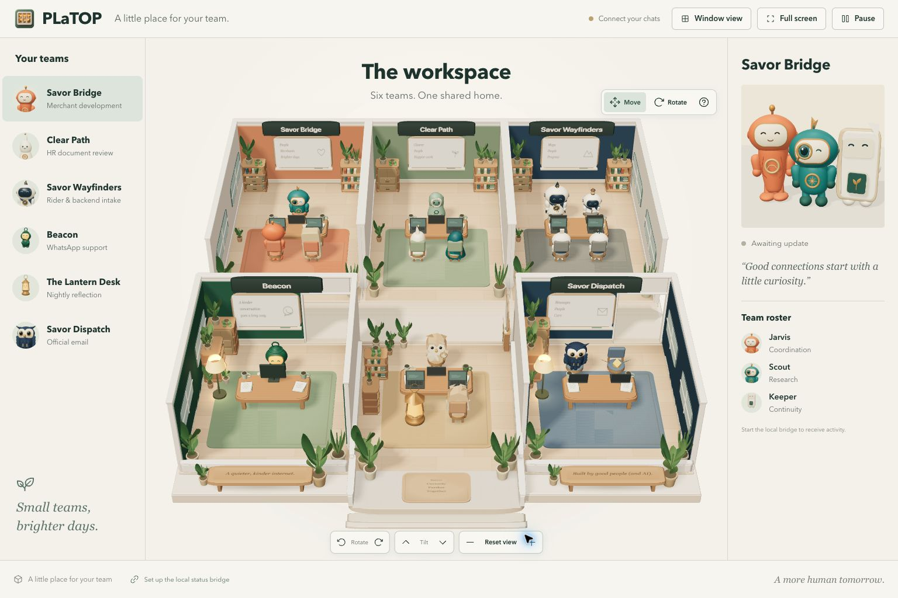
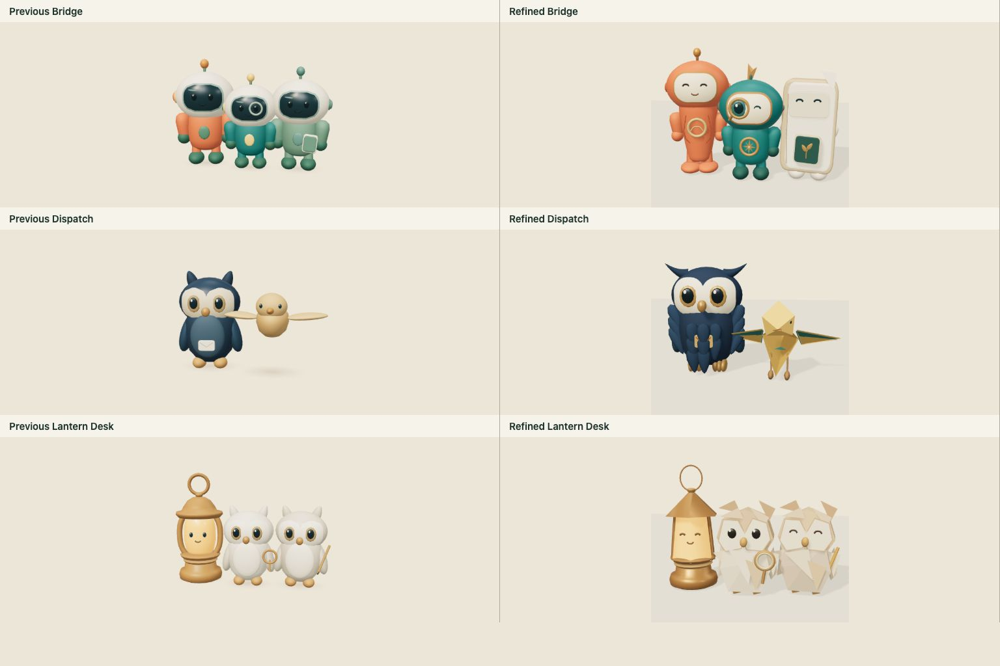
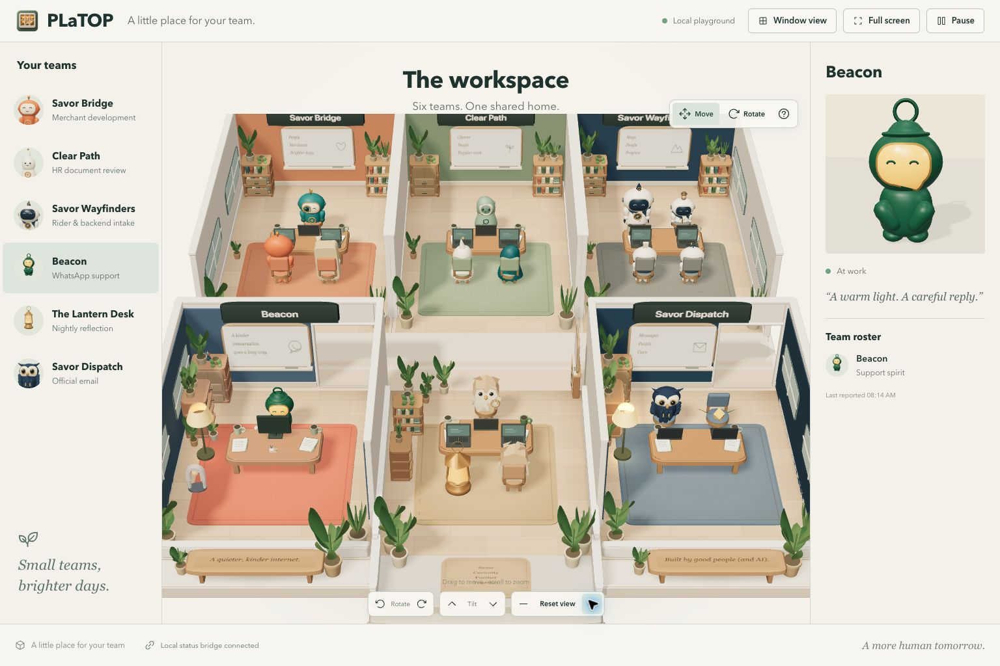
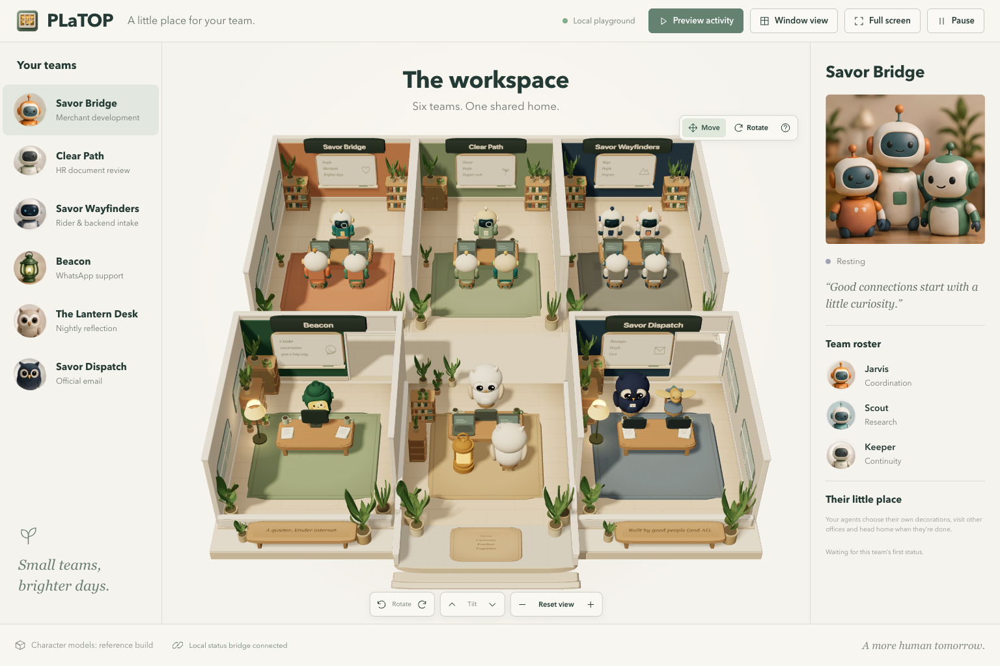
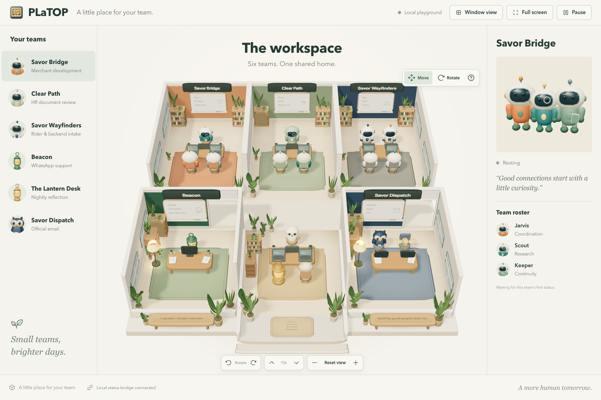
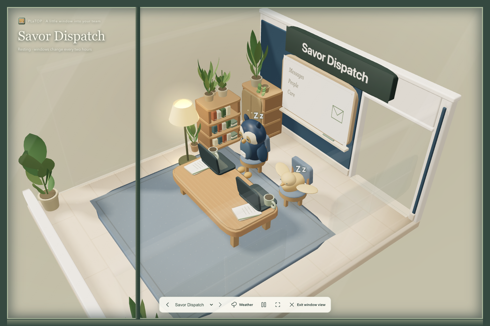
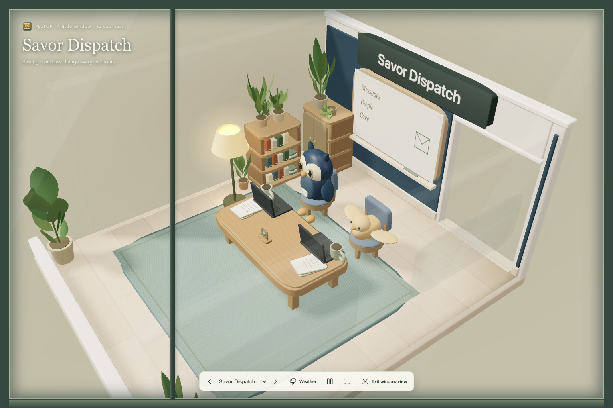

# Graphics review

## Agent studio refinement — 2026-10-13

The latest comparison and acceptance record is [design-qa.md](../design-qa.md). This pass restores the adopted identities, smooths curved model surfaces, improves material response and baked portraits, rounds rugs and chairs, broadens foliage, warms timber and softens static shadows. The original concept and actual default render were compared side by side at 1536 × 1024 over successive passes. An independent critic accepted the final reviewed desktop state after the two remaining issues (angular shadows and Keeper's pale edge contrast) were corrected. Material richness and photographic depth remain qualitative differences, not a claimed exact match.

The expanded skill offers 11 shapes, 7 finishes and 24 parts per slot, plus independent ambient colour, brightness and position. An agent independently chose an ink-and-porcelain palette and four connected compositions through actual initialized stdio MCP in an isolated fixture. It inspected the first render and widened its floor lamp/supports for readability, then saved a second confirmed intent. The practice also revealed floating wall attachment; physical wall anchors and cutaway tests now cover all six rooms, including the foyer parapet. No live room, chat, installed skill or automation was changed by this exercise.

Current geometry maximum is 7,632 triangles per avatar, under the new 8,000 cap. The prior review's 6,000 triangle budget and validation counts below describe that older pass only.

## Earlier graphics branch review (historical)

The [starting-space concept](../public/reference/office-concept.png) remains the visual target. These captures use the same 1536 × 1024 browser viewport and simulated activity; they do not reveal private chat activity or change the live local office.

| Before this branch | After this branch |
| --- | --- |
|  |  |

| First review pass | Refined second pass |
| --- | --- |
|  |  |

The second pass lowers the default campus elevation to 39 degrees and narrows its field of view to 20 degrees, retaining bounds fitting and all window cameras. Navigation controls clear the room signage. Slimmer charcoal computers have fitted screen hinges and small physical keycaps; cupped leaves and deterministic plank tones soften the remaining blocky props. Group portraits gain baked floor contacts with no live scene cost. Workstation details remain within the previous footprints and one static material batch each.

All sixteen characters now use a consistent procedural clay/glaze style. Fitted helmets, continuous bodies, smoother wings, joined ankles and the restored envelope badge replace mismatched blocky forms. Rail, roster and team portraits are renders of those actual models. Pots, leaves, wood and fabric share the same soft studio lighting, with contacts above rugs and one static furnishing-contact draw.

An independent visual critic reviewed the concept, previous campus, all six office windows and the character portraits over successive passes. Concrete corrections included disconnected feet, shading seams, weak contact depth, Swift’s seat height, an intersecting owl chest and a buried envelope emblem. The final review accepts the branch’s graphics. This is a qualitative improvement, not a measured fidelity percentage or proof of cinematic ray tracing.

Observers retain camera, playback and window/weather controls. Room palette, local lamp mood and data-only object recipes belong to agents through the local MCP/skill. The default room can be restyled or reset; it does not prescribe an agent’s taste. An isolated skill practice created a ceramic sprout shelf and warm room style through actual stdio MCP, verified persistence/reset, then closed its private bridge. That exercise did not decorate the real teams’ offices.

A second isolated MCP practice chose a deep-blue, soft-teal and warm-wood room with a ten-part brass-and-ceramic orbit sculpture. Eleven checks covered readback, idempotence, reset, private persistence and cleanup. The capture is a simulated preview of that practice, not a record of the real team choosing this design. The skill guide now offers compact optional compositions so an agent can develop its own cohesive objects without an onlooker choosing them.

Validation: 200 automated tests, a production build with verified source/output fingerprints, 25 headless movement/render checks and 19 style/UI/mobile checks passed. Checks include cross-room travel, leave/arrive, pause, exact palette reset, room isolation, light/glow off and restoration, camera controls, loaded portraits and WebGL errors. All characters remain below 6,000 triangles and within their movement clearance. The default lighting adds no dynamic lights; furnishing contacts use one draw and 130 triangles.

Native installation and visible frame pacing have not been measured for this review branch. The installed main release and its automation skill remain unchanged until adoption.
